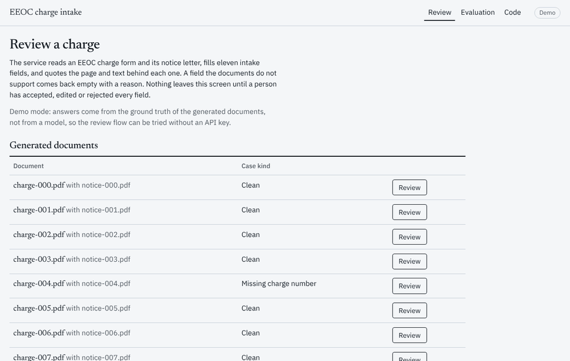

# EEOC charge intake: extraction with source spans and human review

[](https://github.com/iamkevinstreet/eeoc-charge-intake/actions/workflows/ci.yml) [](LICENSE)

Turns a charge of discrimination (the EEOC form and its notice letter) into a structured intake record. Every
field carries the page and the exact text it came from. A field the document does not support comes back empty
with a reason. Nothing is exported until a person has accepted, edited or rejected each field.

Case study with the evaluation plan and results: https://kevindstreet.com/projects/eeoc-charge-intake-extraction/



## How it works

1. `pypdf` reads both PDFs into per-page text.
2. One model call returns the eleven fields as JSON. Each field is a value, a page number, the exact text
   that supports it, the model's confidence, and a reason when the value is empty.
3. Span verification checks every quoted text against the cited page, ignoring case and whitespace. A field
   whose quote is not on its page is emptied before anyone sees it, and the review screen says what the model
   had claimed.
4. A reviewer accepts, edits or rejects each field. The export endpoint returns 409 until every field has a
   decision. The position-statement due date is a rule (notice date plus 30 days), never a model output.

## Layout

| Path | What it is |
| --- | --- |
| `eeoc_intake/schema.py` | `ChargeRecord`: eleven fields, each a value plus page, span, confidence and reason |
| `eeoc_intake/generate.py` | Makes the test documents: charge and notice PDFs with known answers, including hard cases |
| `eeoc_intake/extract.py` | Prompt, structured extraction through the shared adapter, and span verification |
| `eeoc_intake/fake.py` | Offline stand-in that answers from the ground truth, for the smoke run and demo mode |
| `eeoc_intake/api.py` | FastAPI service under `/api`; serves the review screen from `ui/dist` |
| `eeoc_intake/evals/run.py` | The evaluation: accuracy per field, unsupported outputs, abstentions, guesses, time, cost |
| `eeoc_intake/evals/export.py` | Tidy CSV files for Tableau (see `docs/TABLEAU.md`) |
| `eeoc_intake/dashboard.py` | Plotly Dash dashboard comparing runs |
| `eeoc_intake/evals/stats.py` | When a change between runs is bigger than noise, and how a share is written |
| `eeoc_intake/tests/` | Span verification, the review service, the dashboard frames |
| `ui/` | Review screen: React, Vite, TypeScript |
| `.github/workflows/eval-live.yml` | Live evaluation against a real model, started by hand |

## Run it

```sh
make install                       # uv venv, project and dev dependencies, pre-commit
make smoke                         # generate 10 documents and run the offline evaluation (no API calls)
make test                          # 20 tests
make run                           # build the review screen and serve it at http://127.0.0.1:8000
make dashboard                     # evaluation dashboard at http://127.0.0.1:8050
make export                        # CSV files for Tableau in eeoc_intake/evals/results/export/
```

Without an API key the service runs in demo mode: it extracts the generated documents by answering from their
ground truth, and the screen says so. Set `LLM_PROVIDER` and a key in `.env` (see `.env.example`) and it
calls the model, for the generated documents and for uploads.

A live evaluation runs on GitHub: Actions, `eval-live`, Run workflow. It needs `ANTHROPIC_API_KEY` or
`OPENAI_API_KEY` as a repository secret, stops at the budget you give it, and commits the results to the
`eval-results` branch. Merge that branch to publish them under `eeoc_intake/evals/results/live/`.

## What the evaluation measures

Every generated document has known answers, so each run reports, per field and per case kind:

- field accuracy: the final value equals the ground truth
- unsupported outputs: fields the model filled whose quoted text was not on the cited page, and which
  verification removed
- false abstentions: fields left empty that the document supported
- guesses: fields filled when the document had no value
- time and cost per document at list prices, with the date the prices were taken

Case kinds: clean, missing charge number, rotated page, long particulars, two respondents. The offline smoke
run answers from the ground truth and only proves the pipeline; the numbers that matter come from live runs.

## Results

Live runs are committed under `eeoc_intake/evals/results/live/`; the run log is public on the Actions tab.

| Run | Field accuracy | Unsupported outputs | Guesses | False abstentions per document | Median time | Cost per document |
| --- | --- | --- | --- | --- | --- | --- |
| v0.3, claude-sonnet-5-5, 200 documents, Oct 26, 2026 | 100% | 0 | 0 | 0 | 4.5 s | $0.0134 |
| v0.3, claude-sonnet-5-5, 40 documents, Oct 17, 2026 | 100% | 0 | 0 | 0 | 4.2 s | $0.0134 |
| v0.2, claude-sonnet-5-5, 40 documents, Oct 17, 2026 | 93.0% | 0 | 0 | 0.70 | 4.3 s | $0.0119 |

What the first run said: nine of the ten scored fields were right on every document, including the hard cases
(missing charge number, rotated page, long particulars, two respondents). Every miss was the `issues` field,
which the model left empty on 28 of 40 documents. The form has no line that names the issues; they have to be
read out of the particulars, and the prompt had told the model to quote labels "as written", so it abstained.
It never guessed and never cited text that was not there.

What the second run said: with the prompt saying where issues come from and the particulars written the way a
charging party writes them, every field was right on every document. The remaining risk is the one the
documents cannot show: generated particulars are cleaner and more regular than real ones, so 100% here is a
ceiling for the pipeline, not a forecast for real intake. The next step is a harder test set: varied wording,
irrelevant detail, scanned-looking pages.

What the third run said: the same setup on 200 documents instead of 40, so each of the four hard cases had ten
documents instead of two, and every field was right on every document again. With no document wrong out of
200, the share of documents like these with any field wrong is below 1.5% at 95% confidence (the exact
binomial bound, 1 - 0.05^(1/200)); at 40 documents the same bound was 7.2%. That narrows what these documents
can say, not what they cannot: they are still generated, so the harder test set is still the next step.

## Data

All documents are generated. No real charge, person or company appears anywhere in this project.

## Changelog

- v0.3.3, Oct 26, 2026. Seconds per document fits its axis to the documents and counts the few slow ones at
  the edge. Tiles mark a change only when it is bigger than run-to-run noise at 95% confidence, and shares
  never round up to 100%. 26 tests.
- v0.3.2, Oct 26, 2026. Third live run, 200 documents on the v0.3 setup: 100% again, with ten documents for
  each hard case. The case study's figures carry the latest three runs; the review screen uses straight
  quotes. 21 tests.
- v0.3.1, Oct 26, 2026. Dashboard in the same design as the case study, light and dark: a dot plot of fields
  right with the rows that changed highlighted, one heatmap panel per run, tiles that show the change against
  the earlier run. 20 tests.
- v0.3, Oct 17, 2026. Prompt says where `issues` come from and which labels to use. Generated particulars
  describe the actions in plain words instead of naming them. Live runs also save the full extraction for the
  first eight documents, which the interactive demo on the case study uses.
- v0.2, Oct 15, 2026. Review screen with evidence highlighting and gated export; demo mode; per-field
  scoring; live evaluation workflow; Dash dashboard and Tableau export; 18 tests.
- v0.0, Oct 13, 2026. Scaffold: schema, generator, extraction with span verification, service, evaluation.
