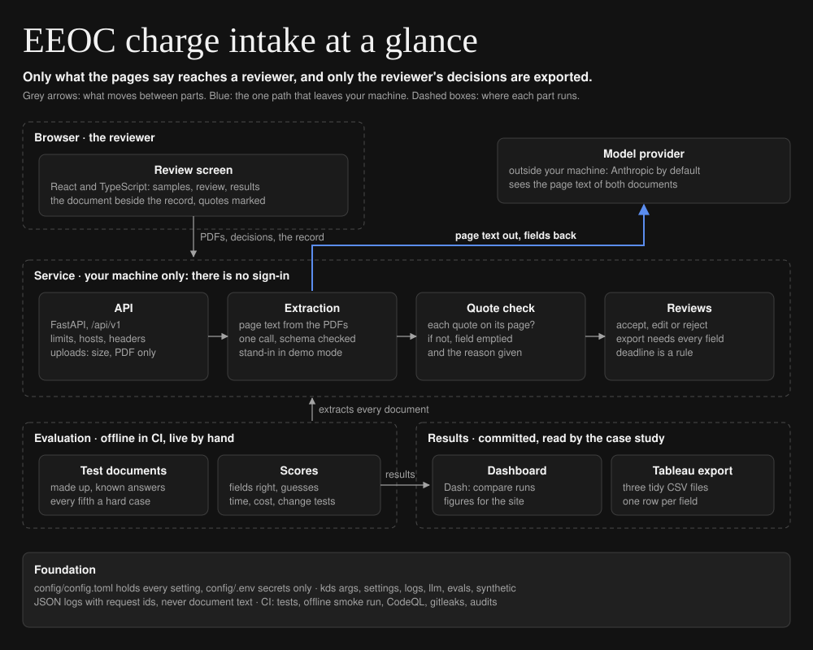
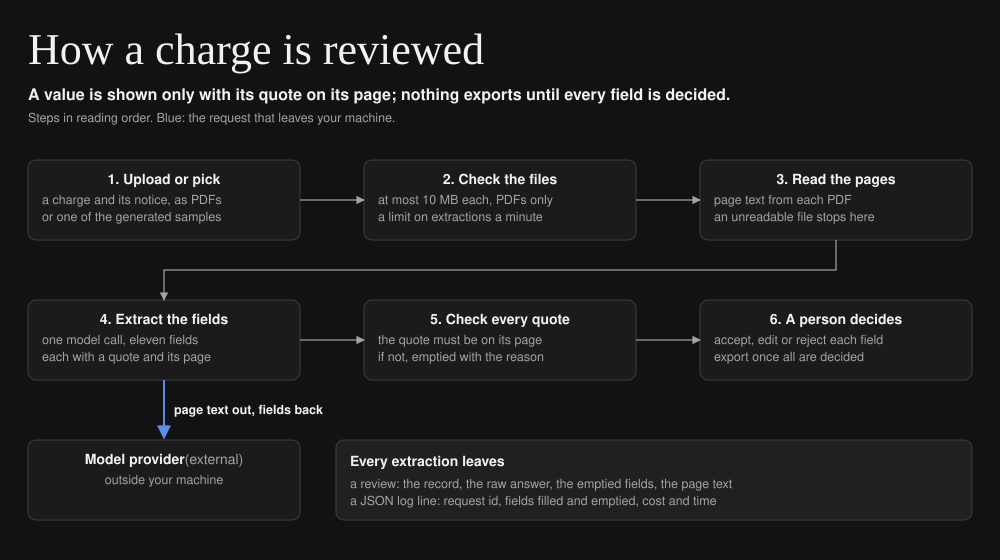

# EEOC charge intake

[](https://github.com/iamkevinstreet/eeoc-charge-intake/actions/workflows/ci.yml)
[](https://github.com/iamkevinstreet/eeoc-charge-intake/actions/workflows/codeql.yml)
[](LICENSE)

Turns a charge of discrimination (the EEOC form and its notice letter) into a structured intake
record for the employer's side. Every field carries the page and the exact text it came from; a field
the documents do not support comes back empty with a reason; and nothing is exported until a person
has accepted, edited or rejected each field.

Case study: <https://kevindstreet.com/projects/eeoc-charge-intake-extraction/>


## Status

| | |
| --- | --- |
| Works today | Extraction with a quote and page for every field, the quote check, the review screen with gated export, demo mode, the evaluation (offline in CI, live by hand), the dashboard and the Tableau export |
| Measured | Three live runs with `claude-sonnet-5-5`, the latest on 200 documents: every field right on every document (below) |
| Next | A harder test set: varied wording, irrelevant detail, pages that look scanned |

Every charge, notice, person and company here is made up: the generator writes them from a seed, with
known answers. No real charge appears anywhere in this project.

## Quick start

Needs [uv](https://docs.astral.sh/uv/) and Node 24. No API key: in demo mode an offline stand-in
answers for the generated documents, and the screen says so.

```sh
git clone https://github.com/iamkevinstreet/eeoc-charge-intake && cd eeoc-charge-intake
make install samples
make run    # the review screen on http://localhost:5173, the API on http://127.0.0.1:8000
```

For a real model, copy `config/.env.example` to `config/.env` and set `ANTHROPIC_API_KEY` there,
then set `[llm] provider` to `anthropic` in `config/config.toml`; the service then extracts the
samples and uploaded PDFs with the model.

## Architecture at a glance



## How it works



1. **Upload or pick:** a charge and its notice as PDFs, or one of the generated samples.
2. **Check the files:** at most 10 MB each, and each must be a PDF; extractions with a real model
   are limited per minute.
3. **Read the pages:** `pypdf` reads each document into page text. A file it cannot read stops here
   with a clear error, before any model call.
4. **Extract the fields:** one model call returns the eleven fields as JSON, each a value, the page,
   the exact text that supports it, the model's confidence, and a reason when the value is empty.
   The answer must fit the record's schema; one repair is allowed.
5. **Check every quote:** each quote is looked for on the page it cites, ignoring case and spacing.
   A field whose quote is not there is emptied before anyone sees it, and the screen says what the
   model had claimed.
6. **A person decides:** accept, edit or reject each field. The export answers 409 until every field
   has a decision. The position statement's due date is a rule (the notice date plus 30 days),
   never a model output.

| Field | From | Field | From |
| --- | --- | --- | --- |
| Charge number | the charge | Earliest date | the charge |
| Charging party | the charge | Latest date | the charge |
| Respondent | the charge (one or a list) | Continuing action | the charge's box |
| EEOC office | the charge | Notice date | the notice |
| Bases | the charge | Summary | the particulars, three sentences, no quote |
| Issues | the particulars, as EEOC labels | | |

## Design

- **Context:** an employer's lawyer gets a charge and a notice and must log the facts that set the
  deadline and the defense: who, against whom, on what basis, for what, when. Copying them by hand
  is slow, and a model that copies them can make a value up.
- **Requirements:** every value backed by text on a cited page; an empty field when the documents
  are silent, with the reason; a person decides every field before anything leaves; repeatable
  results with known answers; no real data anywhere; runs offline with no key.
- **Options considered:** rules over the form's text (rejected: the issues live in free-text
  particulars, and real forms vary); a model with no evidence (rejected: nothing to check a value
  against); a model that quotes, checked by the service (chosen); a second model judging the first
  (deferred: the quote check is exact and free).
- **Chosen solution:** the model reads both documents and quotes its evidence; the service checks
  every quote against its page and empties what it cannot find; a reviewer decides each field; the
  deadline is computed, not extracted.
- **Test plan:** 59 backend and 11 review-screen tests; an offline smoke run on
  generated documents in CI; live runs by hand on 40 to 200 documents across five kinds of
  document, each scored per field against the known answers.
- **Rollout:** local only; live results reviewed on a branch before they merge; the case study shows
  saved extractions, so no one needs a key to see it work. A pilot needs sign-in, a database for
  reviews, and real (consented) documents to measure against.
- **Unresolved:** generated particulars are cleaner and more regular than real ones, so 100% here is a
  ceiling, not a forecast; a scanned PDF has no text layer, so its fields come back empty with
  reasons (there is no OCR yet); reviews live in memory, the newest 200, and are lost on restart; the
  per-client limit lives in memory, so two server processes would each allow six a minute; neither
  the service nor the dashboard has sign-in, so both refuse to listen beyond this machine.

## Results

Live runs, from [data/evals/results/](data/evals/results/) (the latest:
[live-claude-sonnet-5-5-latest.md](data/evals/results/live-claude-sonnet-5-5-latest.md)); the run logs
are public on the Actions tab:

| Run | Fields right | Unsupported values | Guesses | Wrongly blank per document | Median time | Cost per document |
| --- | --- | --- | --- | --- | --- | --- |
| v0.3, claude-sonnet-5-5, 200 documents, Oct 26, 2026 | 100% | 0 | 0 | 0 | 4.5 s | $0.0134 |
| v0.3, claude-sonnet-5-5, 40 documents, Oct 17, 2026 | 100% | 0 | 0 | 0 | 4.2 s | $0.0134 |
| v0.2, claude-sonnet-5-5, 40 documents, Oct 17, 2026 | 93.0% | 0 | 0 | 0.70 | 4.3 s | $0.0119 |

Each run reports, per field and per kind of document (clean, missing charge number, rotated page,
long particulars, two respondents): fields right; unsupported values, which the model filled but the
quote check emptied; guesses, filled where the document had no value; fields wrongly left blank; and
time and cost per document at the list prices of the date shown in the results.

What the first run said: nine of the ten scored fields were right on every document, including the
hard cases. Every miss was `issues`, left empty on 28 of 40 documents. The form has no line that
names the issues; they have to be read out of the particulars, and the prompt had told the model to
quote labels "as written", so it abstained. It never guessed and never cited text that was not there.

What the second run said: with the prompt saying where issues come from, and the particulars written
the way a charging party writes them, every field was right on every document.

What the third run said: the same setup on 200 documents, ten of each hard case, and every field was
right again. With no document wrong out of 200, the share of documents like these with any field wrong
is below 1.5% at 95% confidence (the exact binomial bound, 1 - 0.05^(1/200)); at 40 documents the
same bound was 7.2%. They are still generated documents, so the harder test set is the next step.

## Configuration

Every setting, its default and what it does is in [config/README.md](config/README.md). The ones you
are most likely to change:

| Setting | Default | Lives in |
| --- | --- | --- |
| `[llm] provider`, `[llm] model` | `fake`, `claude-sonnet-5-5` | `config/config.toml` |
| `[samples] count`, `[samples] seed` | `30`, `2026` | `config/config.toml` |
| `[api] max_upload_bytes`, `[api] extracts_per_minute` | `10000000`, `6` | `config/config.toml` |
| `[eval] budget_usd` | `5.0` | `config/config.toml` |
| `ANTHROPIC_API_KEY` | unset | `config/.env` only |

Any setting can be overridden by an environment variable named for its section and key:
`SAMPLES_COUNT=200`. `config.toml` also holds the values two parts of the code share, such as the
API's prefix and the field names, so the service, the dashboard and the review screen read them from
one place.

## Operating it

- **Logs:** one JSON line per event in `logs/YYYY-MM-DD.jsonl` and on stderr. Document text is
  never logged; contact details and ID-like numbers are redacted from everything that is.
- **Metrics:** each `http.request` line carries the method, path, status and time; each `llm.call`
  line one model call's tokens, latency and cost; each `extract.done` line the fields filled and
  emptied, and the extraction's cost and time.
- **Request id:** on every log line and in the `X-Request-ID` header of every response, and saved
  with each review.
- **When something fails:** `GET /api/v1/health` shows the provider, the model and whether this is
  demo mode. A 422 means a PDF could not be read; a 502, the model's answer did not fit the record
  even after a repair; a 503, the model could not be reached or the spending limit was reached
  (look for `llm.error` in the log); a 429, the per-minute limit. An empty sample list means no
  samples were generated: run `make samples`.

## Testing

```sh
make check   # ruff, mypy (strict), kds-standards, ESLint, Stylelint, Prettier, tsc
make test    # the backend and review-screen tests
make eval    # the offline smoke run over the generated documents; no key, no network
```

Tests never call a model or the network: the offline stand-in and scripted answers take its place.
They write only to temporary folders, run from an empty folder so no `config/.env` leaks in,
generate their documents from fixed seeds, and never sleep: retries take an injected wait. CI runs
the checks, the tests and the smoke run on every push to `main` and every pull request, with the
dependency audits, CodeQL and a secrets scan of the whole history. The live evaluation is started by
hand.

## Security

Every value a reviewer sees has its quote checked against its page; nothing exports before every
field is decided; uploads are size-limited, must be PDFs and are never stored under their own names;
the service and the dashboard refuse to listen beyond this machine; requests for any other host name
are refused. Report a vulnerability privately as described in [SECURITY.md](SECURITY.md), which also
lists every control.

## Project layout

```
eeoc-charge-intake/
├── backend/        the service, extraction, evaluation and dashboard (Python)
│   ├── src/eeoc_intake/  core/, api/, evals/, dashboard/
│   └── tests/
├── frontend/       the review screen (React, TypeScript)
│   ├── src/            components/, lib/, styles/
│   └── tests/
├── config/         config.toml: every setting at its default; .env.example: the secrets' names
├── data/           results, saved extractions and Tableau files; generated/ is not committed
├── docs/           diagrams.toml, the two SVGs it draws, and the review screen recording
└── .github/        CI, CodeQL, the live evaluation, Dependabot, CODEOWNERS
```

## Changelog and license

Releases are listed in [CHANGELOG.md](CHANGELOG.md). Shared packages come from
[utils](https://github.com/iamkevinstreet/utils), pinned to one commit.

Parts of this repository were drafted with AI coding assistants. Every change was read, run and
tested before it was kept.

Apache License 2.0. See [LICENSE](LICENSE) and [NOTICE](NOTICE).
